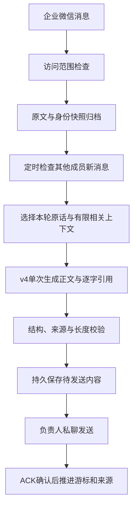

# 企业微信汇报架构

当前定时生成器：`source-first-v4`。秘书负责把原话与变化讲清楚，不负责替老板推断客户动机或作经营决策。



## 接收与存档

`wecom-runtime.js` 检查会话权限，调用 `WeComSecretary.capture` 后处理日常对话。`wecom-secretary.js` 保存原文、来源编号、发送者UserID、接收时间、可用的平台时间以及身份快照。原文档案与可压缩的聊天记忆分开；自称姓名不会改变访问权限或通讯录身份。

只有启用后实际收到并被允许的消息进入秘书档案。它不能读到员工之间未发给机器人的聊天。不同Bot ID隔离数据；跨成员检索仅向配置负责人的私聊开放。

## 定时选材

`tick` 在到期且有其他成员新消息时工作，不把负责人自己的消息当作待报内容。每轮最多处理40条，按单批最多20条或约9000字符分组。`briefingMaterial` 增补受时间、条数与字符预算限制的同会话前后文，以 `contextOnly` 区分背景与本轮新消息。

v4额外在30天内查找最多6条相关候选：显式项目编号可跨会话，同会话支持中文2～4字片段与稀有词匹配。按匹配权重排序，先保留最多4条邻近背景，再合并候选与剩余邻近背景，历史最多12条。跨Bot/负责人原话仍排除，候选必须早于本轮。主动查询传入选项时保持旧邻近路径。

同会话相邻不证明同一事项。长消息可能截断，跨批次更正或遥远历史不保证被读到。不要把“保存了完整档案”理解成“每次生成读取了所有档案”。

## v4生成与校验

`src/wecom-scheduled-briefing.js` 将选中的原文直接交给模型，返回：

```json
{
  "paragraphs": [{
    "text": "面向负责人的自然转告",
    "evidence": [{"source": "消息编号", "quote": "逐字原话片段"}]
  }]
}
```

校验来源存在、引文为原文连续片段、每段有本轮来源、所有本轮消息有来源引用，并限制1至4段、每段220字符、总长650字符。引用覆盖不要求把无关细节写进正文，也不能证明重要事实全部被写出。

每次模型请求上限60秒，HTTP尝试1次。格式或结构错误可以修正一次；正常需要1次请求，结构修正时最多2次。这是每批生成预算，不是整个定时任务的60秒硬截止。失败交回既有队列处理，不用未校验正文兜底。

v4仍没有独立事实计划或长期事实状态库，历史背景不必照抄。重要性、否定、更正范围和不确定性仍依赖模型理解；程序不能通过有效引用证明语义正确。已经观察到旧背景冗余、无关细节保留和开头顺序不稳定，见[真实记录](reports/v3-2026-11-21.md)。

## 投递与恢复

生成结果先保存到outbox。仅在发送ACK后推进对应进度，未确认部分可在断线/重启后续传并复用已有正文。关闭秘书或切换收件人时检查正在进行的任务，避免继续向旧接收人发送。

ACK丢失时，服务端可能已接收而客户端认为失败，重试仍可能造成重复。这里提供持久化与恢复，不承诺严格一次送达。

## 与其他功能的边界

主动查询及 `/汇报` 使用 `wecom-briefing.js`，不是v4定时生成器。QQ仍使用自己的入口与人格；共享LLM客户端的普通调用保留原有默认重试次数，只有显式传入定时选项时限制为1次。

实验复用真实的接收、归档、选材、定时和待发确认逻辑，替换普通聊天与收件人。v3实验的历史摘要由替身准备，本轮模型才是真实请求，因此它不是生产端到端验收。

## 多人多轮评估

专项入口 `scripts/evaluate-business-v4.mjs` 直接调用正式capture、档案加载、选材、tick和writer，收件人使用替身；它不覆盖真实企业微信连接及上游权限入口（后者由既有测试覆盖）。三轮均使用模型时不再用历史摘要替身。容量问答是共享理解规则的诊断接口，不冒充正式聊天/摘要接口。7组各28问按200/2000/10000条历史测试，另有完整相关原文对照与可选全量输入。见[测试设计](../experiments/secretary/BUSINESS-V4.md)。
