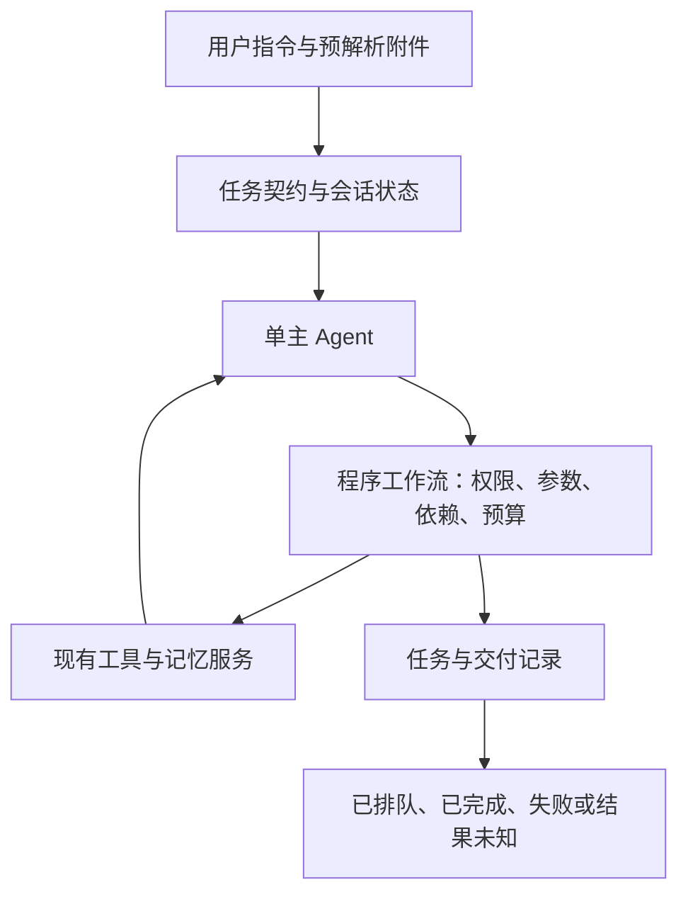

# 单主 Agent 与受控工作流

开启 `chat.agents.enabled` 后，默认编排现在是单主 Agent。第一步仍用结构化任务契约维护多轮状态，但不再调用模型生成跨角色计划、逐个启动专业 Agent、再调用另一个模型做汇总。一个主 Agent 共享工具历史，选择下一步工具并给出回复。



## 责任划分

- `intent.js` / `understanding.js`：结构化任务契约、否定范围、草稿、修改、取消和状态查询。`execution=defer` 是暂缓执行，不是永久禁止。更新未明确开始时保留暂缓状态。
- `single-agent.js`：唯一执行 Agent，共享本轮工具结果与已有会话/自我状态上下文；不创建子 Agent，不调用独立规划或汇总模型。
- `workflows.js`：独立于提示词的执行规则。目前文档阶段依赖本轮要求的检索、汽修、记忆读取和时间查询阶段成功，失败不会开放下游工具。新增业务流程应在这里扩展程序规则，而不是只靠提示词要求模型遵守。
- `capabilities.js`：操作授权、参数绑定、输入完整性和能力限制。超限数量先保留为用户需求，再给出支持范围，不再当作JSON格式损坏。
- 现有 memory、知识库和检索工具继续负责保存和读取数据；现有文档、歌曲和翻唱流程继续负责生成及交付。单主 Agent 无法绕过这些服务的身份或发送限制。

工具的权限来自已确认操作，不来自“Agent会用哪些工具”。工作流的 `trace.steps[].agent` 为兼容既有评测保留能力归属名称，`kind=workflow` 表明这是程序阶段，不是额外LLM Agent；`trace.architecture=single-agent-workflows` 明确标注运行模式。

同一任务内相同参数的工具调用复用结果，避免重复产物。工具响应截断或参数JSON损坏时，整条回复尚未执行任何工具才允许一次格式修复。未知工具、预算耗尽或执行失败不会触发旧路径重新执行。工具内部的网络重试、跨进程幂等仍由原服务负责。

文档/歌曲排队时返回固定的“尚未确认生成或送达”状态。不能靠主 Agent 的措辞将后台队列视为交付成功。生产入口现在持久保存任务状态，文档由交付日志校准并支持受控恢复；歌曲/翻唱等中断后只记录结果未确认，不会自动重做。详见 [任务可靠性](TASK-RELIABILITY.md)。

## 启用与回退

```json
{"chat":{"agents":{"enabled":true,"architecture":"single","maxSteps":4,"maxToolCalls":8,"maxRounds":3,"timeoutMs":120000}}}
```

`maxRounds` 在单主 Agent 模式下是整个工具对话的轮数，格式修复至多额外一次，仍受总时间预算限制。主 Agent 和任务契约输出预算均为4096 token；所有阶段仍保留原超时约束。

`architecture="multi"` 使用保留的 `multi-agent.js` 编排作回退；`enabled=false` 仍回到原有 Brain 路径。回退用于诊断，不代表旧流程同样修复了所有问题。

本次没有接通新的企业催办、SOP审批系统或自主监控业务；空间发布和通用传话仍不向主 Agent 开放，翻唱仍经过原有受控投递器。企业群聊2000条检索与95%准确率需要独立数据和验收，不能由本次40题推导。

## 验证

```bash
node --test --test-concurrency=1 tests/*.test.js
node --use-env-proxy --use-system-ca scripts/evaluate_architecture.mjs --suite=adversarial --live --model=deepseek-v4-pro --out=reports/hybrid-live.html
```

代理参数适用于当前Node.js 24云环境。真实测试仅调用文本模型，业务工具模拟；题库及评分规则保持与改造前一致。改造包含编排、状态契约与输出预算修正，因此结果衡量组合改造，不能单独归因于减少Agent数量，也不是模型权重训练。
