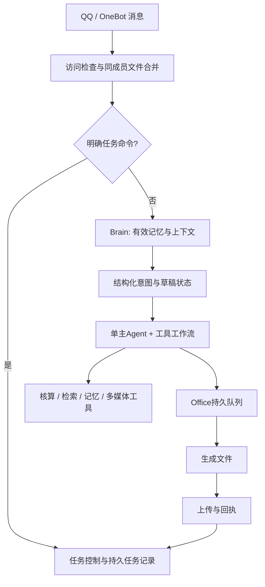

# 当前架构与状态

- 入口：apps/ojj-qq-agent/src/index.js、file-batches.js。
- 理解执行：brain.js、agents/intent.js、understanding.js、single-agent.js、workflows.js。
- 任务：task-state.js、task-control.js；原子JSON写入，同一目录单进程。
- 交付：office-delivery.js、reply.js、onebot.js。排队→生成中→已生成→上传中→成功/明确失败/结果未知。
- 重启：未开始的文件暂停；生成中断记录未确认；上传中断记为未知。用户明确继续，已生成文件可从上传步骤继续。
- 记忆：memory.js、memory-handles.js。保存不受40条提示窗口限制；本轮短编号严格映射真实存储ID。
- 任务命令：/tasks、/task 编号、/cancel 编号、/resume 编号、/retry 编号。

源码提供旧模式回退，但本轮验收使用 single 架构；新配置默认启用。评测结果不代表已远程部署。
